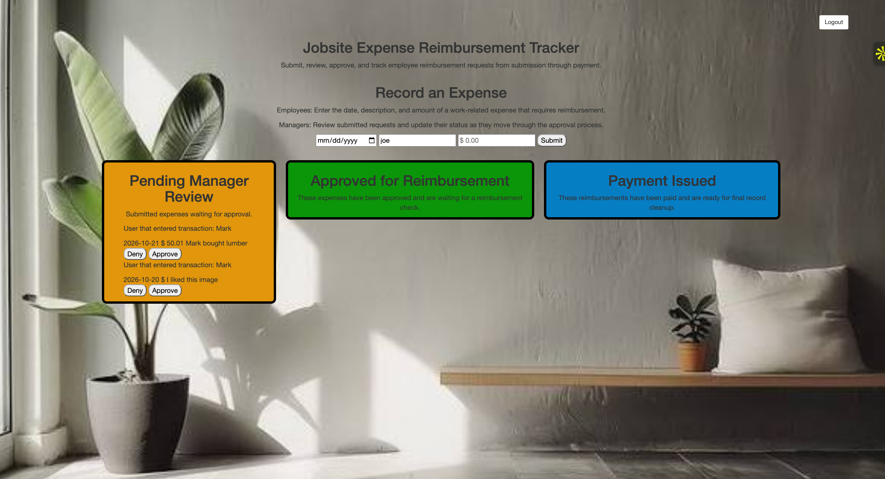

# Fullstack-Expense-Tracker
Employee and Managers can use this to track reimbursement requests!  

# Link
https://fullstack-expense-tracker-udgf.onrender.com/

# 📋 How to use
Click on link.    
If employee, enter reimbursement request. If manager, either approve or deny request, then record if check written!   

# 📷 Images

# ✨ Features
Fully responsive design for desktop and mobile.         

# 🔨 Built With
HTML5 – structure,    
CSS3 – responsive design and background,    
JavaScript - frontend and backend.  
Node - backend.  

# 🧠 What I Learned
How to work with Node.    
How to work with APIs.   
How to use fetch().   
How to work with JSON data.  
How to manipulate the DOM.  
How to handle errors.  
